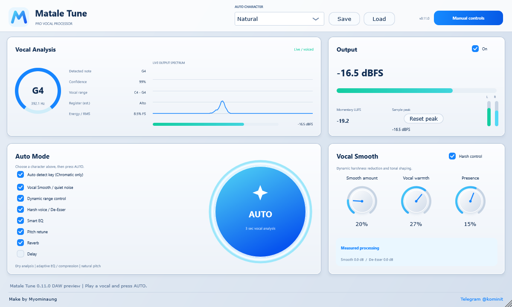
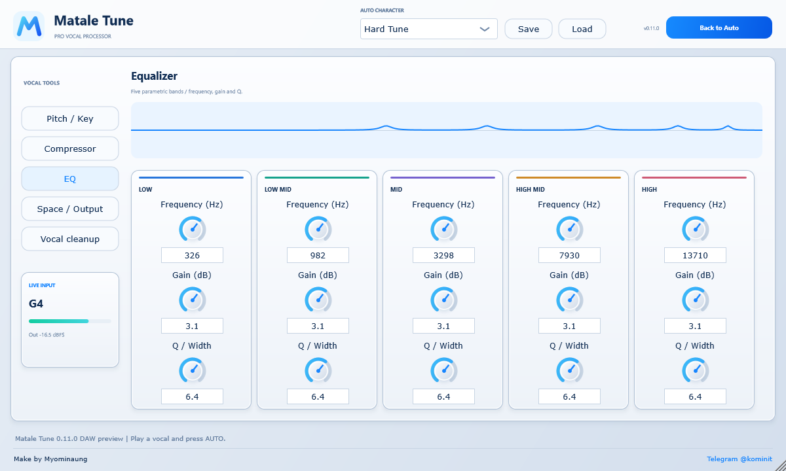

# Matale Tune

**A browser-first vocal processor with realtime pitch correction, key estimation
and an independent monophonic note editor.**

[Download the browser preview](https://github.com/shwesiads-ctrl/b-tune/archive/refs/heads/browser-preview.zip) ·
[MIT license](LICENSE) · [Third-party notices](THIRD_PARTY.md)

**Native product direction:** VST3/AU will use the compact four-panel vocal
processor; Standalone will include the full workbench. See
[product scope](PRODUCT-SCOPE.md). The compact native processor/editor is now implemented with 0.9.0 Manual controls;
Windows binary build status is published separately. The full native Standalone
application remains planned; the browser workbench remains available.

[Windows VST3 build status / download](https://github.com/shwesiads-ctrl/b-tune/tree/daw-preview-windows) ·
[DAW installation and test guide](project/docs/DAW-TESTING.md)


## စတင်အသုံးပြုရန် / Quick start

1. ZIP ကို ဒေါင်းလုဒ်လုပ်ပြီး အပြည့်အစုံ ဖြည်ပါ။
2. `MataleTune-Browser` folder ကို ဖွင့်ပါ။
3. Windows: `Start-Browser-Windows.bat` ကို ဖွင့်ပါ။
4. macOS/Linux: အဲဒီ folder ထဲမှာ `python3 Start-Browser.py` run ပါ။
5. Python 3 လိုအပ်ပါတယ်။ Chrome/Edge browser အလိုအလျောက် ပွင့်လာပါမယ်။
6. **Vocal file** သို့မဟုတ် **Mic input** ကို ရွေးပါ။ Mic monitor ဖွင့်မယ်ဆိုရင် နားကြပ်သုံးပါ။

The ready-built preview requires Python 3, no npm installation. Do not open
`index.html` directly. Audio stays on your computer; no account or cloud API
is used. Stop releases the audio input. Ctrl+C in the launcher terminal stops
the local server. Use `python3 Start-Browser.py --port 0` if the port is occupied.

## 404 / old browser tab

Always start the launcher from the fully extracted `MataleTune-Browser` folder.
Use the exact new URL it opens; do not keep manually reopening an old 8765 tab.
Version 0.4.1 checks the build and page before opening the browser and selects a
free port if another server occupies the preferred port. It does not kill other
programs. Keep the extracted files in place while the launcher runs.

For an immediate workaround in an older download, open a terminal in that folder:

```sh
# Windows
py -3 Start-Browser.py --port 0
# macOS/Linux
python3 Start-Browser.py --port 0
```

The source launcher can also find the ready-built sibling package. If files
are incomplete, it reports extraction/build instructions instead of opening a
broken page. If you move/delete a running build, its page asks you to restart.

## Working features

| Area | What it does |
| --- | --- |
| Realtime vocal control | Input gain, Auto Pitch on/off, correction strength, retune, humanize, output and monitor levels update while audio runs. |
| Auto Pitch | Existing monophonic WASM pitch correction targets your chosen key/scale. Natural and Hard Tune styles are available. |
| Detect Key | Analyses the loaded file, or captures up to 10 seconds of live voiced notes. Shows major/minor candidates and lets you apply a key explicitly. |
| Vocal Note Editor | Analyses solo vocal notes in a worker, supports vertical note dragging/keyboard/knob edits, scale correction, undo/redo, rendering, original/edited preview and WAV export. |
| Vocal processing | Compressor, five-band EQ, linked De-Esser, dynamic Smooth/Harsh control, Warmth/Presence, Reverb and Delay. |
| State | Built-in presets, browser save and JSON import/export, A/B snapshots, individual stage switches and scoped Auto proposals. |
| Measurements | Pitch periodicity, observed note range/register estimate, RMS input energy, spectrum/waveform, momentary LUFS, L/R and held sample peaks. |
| UI | Rotary controls instead of sliders, full-width responsive layout, standard/large/extra-large interface sizes and explanatory labels. |

### Realtime workflow

Start the microphone or a vocal file. Select Key, Scale and Style. Enable
**Auto Pitch** in **Vocal Realtime Control** and adjust Correction / Retune /
Humanize while listening. The large **AUTO** button is a separate three-second
setup analyser; it is not the realtime pitch-correction switch.

### Key detection

Press **Detect Key** with a vocal file loaded. With microphone input active,
sing several notes and press **Finish key capture**, or wait 10 seconds.
A single sustained note cannot determine a musical key. Scores are correlations
to pitch-class profiles, not probability or AI certainty. Relative major/minor
and ambiguous melodies may need your accompaniment to resolve; choose a listed
candidate to apply it. Detection does not overwrite your key automatically.

### Note editing

1. Load a clean solo vocal and open **Note Editor**.
2. Press **Analyse notes**; select a note in the piano roll.
3. Drag vertically, use ↑/↓, or turn **Selected note pitch**. Use **Correct to
   scale** for automatic note targets. Undo/Redo and Reset edits are available.
4. Press **Render edits**, then **Preview edited** or **Export WAV**.

This is original project code, **not Celemony Melodyne**, and includes no
Celemony code, plugin, license or proprietary algorithm. The editor currently
supports mono/stereo monophonic vocal clips up to 10 minutes, pitch edits up
to one octave and fixed timing. It does not provide polyphonic separation,
formant-preserving resynthesis, detailed vibrato editing or note timing edits.
WAV export contains the note edits only; current realtime effects are applied
on playback. Realtime Auto Pitch is bypassed during editor previews so it does
not undo intentional note edits. The original file is retained.

## Development

Editable source: [`project/`](project/). Prebuilt browser: [`MataleTune-Browser/`](MataleTune-Browser/).

Requires Node.js 22+:

```sh
cd project/Web
npm ci
npm run build
npm run test:dsp
npm run test:session
npx playwright install chromium
npm run test:browser
```

`MATALE_CHROMIUM_PATH` can select an existing Chromium;
`MATALE_SCREENSHOTS` retains browser screenshots. Native source/build scripts
are provided in `project/`; VST3, Standalone and AU release work remains
separate from this browser review. New browser-only tools are not yet native
plugin features.

## Validation and limitations

Signal tests check actual processing, pitch changes and exported PCM at
44.1/48/96 kHz. Chromium checks file/microphone processing, controls, presets,
key detection and note editing. Browser fixtures are synthetic: real vocal
listening, physical hardware, other browsers and native host validation still
need testing. Existing 2048-frame realtime DSP latency is additional to device
and browser latency. Register/key readings are estimates, and LUFS is momentary
rather than integrated/true-peak loudness. See [feature notes](project/docs/PITCH-WORKFLOW.md).

## License

Original Matale Tune project code is licensed under [MIT](LICENSE).
Dependencies retain their own licenses; this does **not** relicense JUCE.
Native JUCE 8 modules require compliance with their AGPLv3 or commercial JUCE
license. Browser React dependencies and toolchain notices are documented in
[THIRD_PARTY.md](THIRD_PARTY.md). No third-party vocal recordings are included.

### Browser 0.4.2

Vocal playback now shows elapsed / total time with a live progress bar, Pause / Resume, Restart and ±10-second buttons (no sliders). Opening Note Editor automatically analyses the loaded vocal and scrolls to the piano roll. Status and errors appear above the notes. Preview edited renders the current edits automatically before playback; Export WAV becomes available after rendering. Mono/stereo note editing still supports clips up to 10 minutes; use a clean solo vocal.

Browser 0.4.3 fixes a global 130px CSS cap on the vocal playback progress bar. The timeline now fills its panel and uses a consistent green / blue fill in Chromium and Firefox.

Browser 0.4.4 adds click-to-seek on the full playback timeline. Tab to the timeline and use Left/Right for 5-second jumps, Home for the beginning and End for the end. Seeking preserves the paused/playing state. Effect controls remain rotary knobs.

### Browser 0.5.0 — compact tabs and Denoise

Only Home shows the full analysis dashboard. Pitch shows its musical target and realtime controls; Dynamics, EQ and Effects show their own controls. Settings and Note Editor hide unrelated dashboard panels. The header, navigation and playback transport are more compact.

The Denoise tab provides rotary Amount and Threshold controls for a stereo-linked downward expander before the shared pitch/effects engine. It attenuates quiet background noise between phrases, with a 2ms opening envelope and 120ms release; it does not separate noise underneath a singing voice. Amount 0 and master bypass preserve the dry input. Start low and lower the threshold if soft words are cut. Denoise defaults to bypass; older presets remain compatible and new presets / A–B snapshots retain these controls.

### Browser 0.6.0

- Note Editor and Detect Key process vocals up to 10 minutes in 30-second analysis jobs, with progress and cancellation. The full file is retained; rendering accepts mono/stereo and at most 60 million total channel samples to bound memory. A sustained note crossing a job boundary can appear as adjacent notes. Long-file time labels are spaced automatically.
- Playback seeking stays transparent on hover, press and focus so the progress fill remains visible.
- Presets still apply on selection, with an explicit Apply preset button to reapply the selected preset and a visible operation status. Warm and Bright presets include more distinct EQ/dynamics settings. Existing saved presets retain their original compressor mode.
- EQ has a dark interactive response graph with five draggable band nodes and rotary controls for the selected band. The existing frequency ranges, gain and Q remain connected to the shared audio engine.
- The original Opto Leveling Compressor offers Peak Reduction, Gain, Compress/Limit and measured gain reduction. It uses an RMS detector and a two-timescale release; the standard compressor remains selectable. Opto mode bypasses the shared compressor to avoid double processing. This is not a FabFilter or LA-2A product or an exact circuit emulation.

### Browser 0.7.0 — adaptive Clean Vocal Auto

Auto now measures stereo dry input before denoise, compression and EQ, avoiding feedback from an earlier Auto pass. Three seconds of voiced material produces bounded broad EQ adjustments for rumble/mud/presence/air, opto compression and makeup based on RMS/crest/headroom, de-essing/smoothing and restrained 4% reverb / 2% delay. Included processing stages and master processing are enabled; included pitch returns to Natural style and full correction. Excluded groups and manually selected keys/scales are retained. Resume playback before running Auto.

With Auto detect key enabled and Chromatic selected, Auto evaluates the captured melody and applies only a sufficiently strong, unambiguous major/minor candidate. Ambiguous or insufficient melody asks for Key/Scale or a longer Detect Key pass. A short melody cannot guarantee the key of an entire song; badly clipped/noisy input and polyphonic recordings still require preparation.

Opto compression adds a 6 dB soft knee, program-dependent two-stage release, adjustable 20–250 Hz sidechain high-pass and parallel Mix. EQ adds a local bypass, selected-band reset and full EQ reset. All remain real audio controls.

A stereo-linked output safety limiter uses 128 samples of lookahead and a −0.45 dBFS sample-peak ceiling, with an 80 ms release. It preserves stereo ratios and meters measure its actual output. Settings exposes its switch and reduction. Enabled processing adds 128 samples to the shared 2048-sample DSP delay (2176 total; browser/device latency is additional). Master bypass remains dry. This is sample-peak protection, not true-peak mastering. Older presets load with default sidechain/mix/safety values.

## Native DAW preview

[Latest Windows VST3: 0.11.0 with response styles and studio cards](https://github.com/shwesiads-ctrl/b-tune/raw/8c63a4a4c4542c89eeb95ebab0801766efb5517b/MataleTune-Windows-x64-VST3.zip)

VST3/AU share a compact four-panel JUCE editor: Vocal Analysis, Output, Auto
Mode and Vocal Smooth. Native Auto measures dry stereo audio, estimates key
when sufficiently clear, and applies included pitch/EQ/opto compression,
smoothing, de-essing, quiet-noise gating and restrained effects. State includes
the native vocal controls and Auto inclusions. Auto result application runs on
the processor's message-thread timer even with the editor closed. The native
audio path allocates no memory after preparation and reports 2176 samples
including its stereo-linked safety lookahead; native bypass stays aligned.

**Manual controls** opens Pitch/Key, Compressor, five-band EQ, Delay/Reverb/Output
and Vocal/Denoise pages. All 48 controls edit real saved/automated DSP parameters.
Continuous controls are rotary knobs with editable values and double-click reset.
**Back to Auto** returns to the compact panels without resetting edits. Disable
Opto compressor to adjust the standard ratio/attack/release controls.

The Windows workflow builds with MSVC x64, runs core/actual JUCE tests and
pluginval strictness 5, then publishes a native ZIP and SHA-256 to the
`daw-preview-windows` branch. A failed run publishes logs/status, not a new ZIP.
A build/status page is not proof of success: check its source revision and
success state before downloading. The ZIP is for DAW testing, with real host
compatibility and listening still to be verified by users.

### Previous verified Windows 0.8.0 download

[Download Windows x64 VST3](https://github.com/shwesiads-ctrl/b-tune/raw/8777bb968c233d74285a75c2e04677a225a2b337/MataleTune-Windows-x64-VST3.zip)
(3.68 MB) · [build/test evidence](https://github.com/shwesiads-ctrl/b-tune/actions/runs/38609482052).

Windows MSVC build, 10 native suites and pluginval strictness 5 passed for source
`7671f7b343c52f57de48ea6600d9f2de48157f7d`. ZIP CRC, bundled source revision,
SHA-256 and the PE x64 module were independently checked after download.
SHA-256: `e76c3562c7fb2dfd3c97f25521cc2ee1603f99c3a623366cc8d57dc5d8aa256d`.
The standalone Steinberg VST3 validator and AU validation were not run. Actual
DAW insertion/listening/recall remain for the DAW test.



### Verified Windows 0.9.0 with Manual controls

[Download Windows x64 VST3 0.9.0](https://github.com/shwesiads-ctrl/b-tune/raw/56c669cf0bc3919926de2cb592e45300dc45deba/MataleTune-Windows-x64-VST3.zip)
(3.69 MB) · [Windows build/test evidence](https://github.com/shwesiads-ctrl/b-tune/actions/runs/38614002580).

Source `e50b67fbbb1a11b0381e0b18e77fad94067a1d33`: Windows MSVC build,
10 native suites and pluginval strictness 5 passed. The ZIP CRC, matching source,
PE x64 module and SHA-256 were independently verified after publication.
SHA-256: `4e9bbf79c3d119580f7d02e1f3178d67a8e74a6685ee13f7dd92dd5e7edb430d`.
Close the DAW and replace the entire `Matale Tune.vst3` bundle in
`C:\Program Files\Common Files\VST3\`, then reopen/rescan. Click **Manual controls**
at the bottom right, choose a page and adjust knobs. **Back to Auto** retains edits.
The user demonstrated the previous version loading in Cubase; listening and
project recall of this version remain DAW checks.



## Native UI branding (0.9.1)

The native editor now displays a scalable Matale Tune vector mark and name in
a permanent header. The footer includes **Make by Myominaung** and
[Telegram @kominit](https://t.me/kominit), retained in both Auto and Manual views.
The visual refresh adds shaded rotary knobs, spectrum fill/grid, consistent
checkboxes and a prominent header Manual button. All parameter IDs and audio
processing remain unchanged. Windows MSVC build, all 10 native suites and pluginval strictness 5 passed.

### Verified Windows 0.9.1 branded UI download

[Download Windows x64 VST3 0.9.1](https://github.com/shwesiads-ctrl/b-tune/raw/67d5294076d67f1dfd52a89e9b65ea5ca74147d7/MataleTune-Windows-x64-VST3.zip)
(3.69 MB) · [Windows build/test evidence](https://github.com/shwesiads-ctrl/b-tune/actions/runs/38617599693).

Source `7190afb6c91f881c8a9ae4c98af48e07eee9273a` includes explicit Segoe UI
typography for Windows. Native tests passed 10/10 and pluginval strictness 5
passed. The published ZIP CRC, matching source, SHA-256 and PE x64 module were
independently checked. SHA-256:
`2160861ae9295e6433e028abf168ed8becd34663f061aada5aadd4561522c0a5`.

Close the DAW, replace the whole `Matale Tune.vst3` folder in
`C:\Program Files\Common Files\VST3\`, then reopen/rescan.


## Native presets and grouped controls (0.10.0)

The native header now includes **Natural / Clear / Warm / Bright / Hard Tune**
starting presets and **Save / Load** for full `.matalepreset` files. Choosing a
character changes the starting sound immediately; **AUTO** adapts that character
to measured vocal input. Your manual Key/Scale and excluded Auto groups remain
respected during analysis. Manual pages use navigation buttons, grouped modules,
live input feedback and a real five-band EQ response curve.

See [native preset usage and DAW checks](project/docs/NATIVE-PRESETS.md).
Windows MSVC build, all 10 native suites and pluginval strictness 5 passed.

### Verified Windows 0.10.0 download

[Download Windows x64 VST3 0.10.0](https://github.com/shwesiads-ctrl/b-tune/raw/da1d18ad0973c53bb4ac9760cc327714d0b3e1f7/MataleTune-Windows-x64-VST3.zip)
(3.71 MB) · [Windows build/test evidence](https://github.com/shwesiads-ctrl/b-tune/actions/runs/38703172936).

Source `52bac034d90b7352d5fa614b2d8019848b714198`: Windows MSVC build,
10/10 native tests (including real preset files and measured character-aware
Auto) and pluginval strictness 5 passed. Archive CRC, matching source, version,
SHA-256 and PE x64 module were independently verified after publication.
SHA-256: `7ad0a231ac08590ac431d21d03ee310fccb2518238edca0f67d2a4ca79dda6a4`.

Close the DAW and replace the whole `Matale Tune.vst3` bundle in
`C:\Program Files\Common Files\VST3\`, then reopen/rescan. Choose an Auto character,
use AUTO on a vocal phrase, and Save / Load `.matalepreset` files from the header.


## Studio contrast and pitch styles (0.11.0)

EQ band headings now read **Low / Low Mid / Mid / High Mid / High**. Stronger
card borders, shadows, background contrast and band colours distinguish the
control groups. Pitch / Key provides **Neutral / Soft / Tight / Pop / Rap /
Ballad** response styles alongside the existing Natural / Hard Tune mode.
Styles change the live Natural-mode pitch response; Save/Load retains them and
older 0.10 preset files remain supported. Windows native tests and pluginval strictness 5 passed.

### Verified Windows 0.11.0 download

[Download Windows x64 VST3 0.11.0](https://github.com/shwesiads-ctrl/b-tune/raw/8c63a4a4c4542c89eeb95ebab0801766efb5517b/MataleTune-Windows-x64-VST3.zip)
(3.72 MB) · [Windows build/test evidence](https://github.com/shwesiads-ctrl/b-tune/actions/runs/38705652203).

Source `d9113a98facb0159f0b32a9bd04c430cb90a657f`: MSVC x64 build, all
10 native suites and pluginval strictness 5 passed. ZIP CRC, matching source,
version, SHA-256 and PE x64 module were independently checked after publication.
SHA-256: `90d6cadb3ced950734c6ce5ec3cab59e7d055c464869d93e1b1101f23d274378`.
Close the DAW, replace the complete `Matale Tune.vst3` folder in
`C:\Program Files\Common Files\VST3\` and reopen/rescan.


