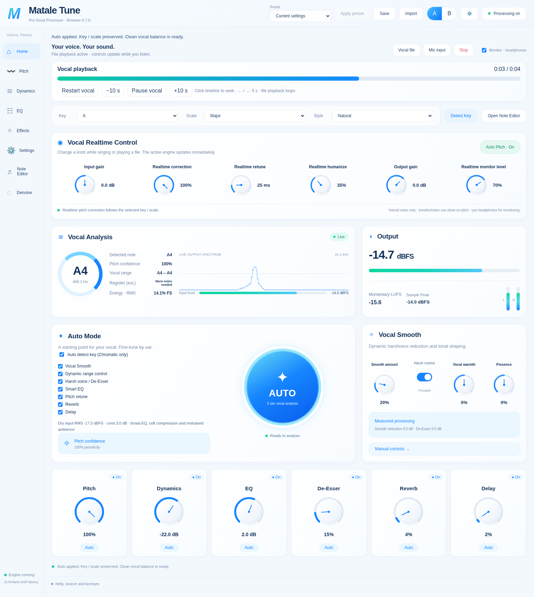

# Matale Tune

**A browser-first vocal processor with realtime pitch correction, key estimation
and an independent monophonic note editor.**

[Download the browser preview](https://github.com/shwesiads-ctrl/b-tune/archive/refs/heads/browser-preview.zip) ·
[MIT license](LICENSE) · [Third-party notices](THIRD_PARTY.md)



## စတင်အသုံးပြုရန် / Quick start

1. ZIP ကို ဒေါင်းလုဒ်လုပ်ပြီး အပြည့်အစုံ ဖြည်ပါ။
2. `MataleTune-Browser` folder ကို ဖွင့်ပါ။
3. Windows: `Start-Browser-Windows.bat` ကို ဖွင့်ပါ။
4. macOS/Linux: အဲဒီ folder ထဲမှာ `python3 Start-Browser.py` run ပါ။
5. Python 3 လိုအပ်ပါတယ်။ Chrome/Edge browser အလိုအလျောက် ပွင့်လာပါမယ်။
6. **Vocal file** သို့မဟုတ် **Mic input** ကို ရွေးပါ။ Mic monitor ဖွင့်မယ်ဆိုရင် နားကြပ်သုံးပါ။

The ready-built preview requires Python 3, no npm installation. Do not open
`index.html` directly. Audio stays on your computer; no account or cloud API
is used. Stop releases the audio input. Ctrl+C in the launcher terminal stops
the local server. Use `python3 Start-Browser.py --port 0` if the port is occupied.

## 404 / old browser tab

Always start the launcher from the fully extracted `MataleTune-Browser` folder.
Use the exact new URL it opens; do not keep manually reopening an old 8765 tab.
Version 0.4.1 checks the build and page before opening the browser and selects a
free port if another server occupies the preferred port. It does not kill other
programs. Keep the extracted files in place while the launcher runs.

For an immediate workaround in an older download, open a terminal in that folder:

```sh
# Windows
py -3 Start-Browser.py --port 0
# macOS/Linux
python3 Start-Browser.py --port 0
```

The source launcher can also find the ready-built sibling package. If files
are incomplete, it reports extraction/build instructions instead of opening a
broken page. If you move/delete a running build, its page asks you to restart.

## Working features

| Area | What it does |
| --- | --- |
| Realtime vocal control | Input gain, Auto Pitch on/off, correction strength, retune, humanize, output and monitor levels update while audio runs. |
| Auto Pitch | Existing monophonic WASM pitch correction targets your chosen key/scale. Natural and Hard Tune styles are available. |
| Detect Key | Analyses the loaded file, or captures up to 10 seconds of live voiced notes. Shows major/minor candidates and lets you apply a key explicitly. |
| Vocal Note Editor | Analyses solo vocal notes in a worker, supports vertical note dragging/keyboard/knob edits, scale correction, undo/redo, rendering, original/edited preview and WAV export. |
| Vocal processing | Compressor, five-band EQ, linked De-Esser, dynamic Smooth/Harsh control, Warmth/Presence, Reverb and Delay. |
| State | Built-in presets, browser save and JSON import/export, A/B snapshots, individual stage switches and scoped Auto proposals. |
| Measurements | Pitch periodicity, observed note range/register estimate, RMS input energy, spectrum/waveform, momentary LUFS, L/R and held sample peaks. |
| UI | Rotary controls instead of sliders, full-width responsive layout, standard/large/extra-large interface sizes and explanatory labels. |

### Realtime workflow

Start the microphone or a vocal file. Select Key, Scale and Style. Enable
**Auto Pitch** in **Vocal Realtime Control** and adjust Correction / Retune /
Humanize while listening. The large **AUTO** button is a separate three-second
setup analyser; it is not the realtime pitch-correction switch.

### Key detection

Press **Detect Key** with a vocal file loaded. With microphone input active,
sing several notes and press **Finish key capture**, or wait 10 seconds.
A single sustained note cannot determine a musical key. Scores are correlations
to pitch-class profiles, not probability or AI certainty. Relative major/minor
and ambiguous melodies may need your accompaniment to resolve; choose a listed
candidate to apply it. Detection does not overwrite your key automatically.

### Note editing

1. Load a clean solo vocal and open **Note Editor**.
2. Press **Analyse notes**; select a note in the piano roll.
3. Drag vertically, use ↑/↓, or turn **Selected note pitch**. Use **Correct to
   scale** for automatic note targets. Undo/Redo and Reset edits are available.
4. Press **Render edits**, then **Preview edited** or **Export WAV**.

This is original project code, **not Celemony Melodyne**, and includes no
Celemony code, plugin, license or proprietary algorithm. The editor currently
supports mono/stereo monophonic vocal clips up to 120 seconds, pitch edits up
to one octave and fixed timing. It does not provide polyphonic separation,
formant-preserving resynthesis, detailed vibrato editing or note timing edits.
WAV export contains the note edits only; current realtime effects are applied
on playback. Realtime Auto Pitch is bypassed during editor previews so it does
not undo intentional note edits. The original file is retained.

## Development

Editable source: [`project/`](project/). Prebuilt browser: [`MataleTune-Browser/`](MataleTune-Browser/).

Requires Node.js 22+:

```sh
cd project/Web
npm ci
npm run build
npm run test:dsp
npm run test:session
npx playwright install chromium
npm run test:browser
```

`MATALE_CHROMIUM_PATH` can select an existing Chromium;
`MATALE_SCREENSHOTS` retains browser screenshots. Native source/build scripts
are provided in `project/`; VST3, Standalone and AU release work remains
separate from this browser review. New browser-only tools are not yet native
plugin features.

## Validation and limitations

Signal tests check actual processing, pitch changes and exported PCM at
44.1/48/96 kHz. Chromium checks file/microphone processing, controls, presets,
key detection and note editing. Browser fixtures are synthetic: real vocal
listening, physical hardware, other browsers and native host validation still
need testing. Existing 2048-frame realtime DSP latency is additional to device
and browser latency. Register/key readings are estimates, and LUFS is momentary
rather than integrated/true-peak loudness. See [feature notes](project/docs/PITCH-WORKFLOW.md).

## License

Original Matale Tune project code is licensed under [MIT](LICENSE).
Dependencies retain their own licenses; this does **not** relicense JUCE.
Native JUCE 8 modules require compliance with their AGPLv3 or commercial JUCE
license. Browser React dependencies and toolchain notices are documented in
[THIRD_PARTY.md](THIRD_PARTY.md). No third-party vocal recordings are included.

### Browser 0.4.2

Vocal playback now shows elapsed / total time with a live progress bar, Pause / Resume, Restart and ±10-second buttons (no sliders). Opening Note Editor automatically analyses the loaded vocal and scrolls to the piano roll. Status and errors appear above the notes. Preview edited renders the current edits automatically before playback; Export WAV becomes available after rendering. Mono/stereo note editing still supports clips up to 120 seconds; use a clean solo vocal.

Browser 0.4.3 fixes a global 130px CSS cap on the vocal playback progress bar. The timeline now fills its panel and uses a consistent green / blue fill in Chromium and Firefox.
